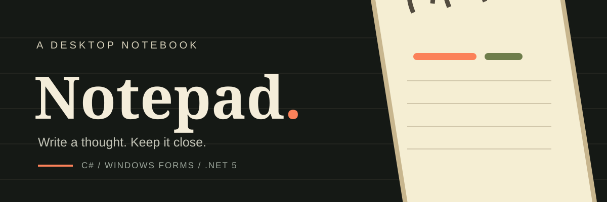
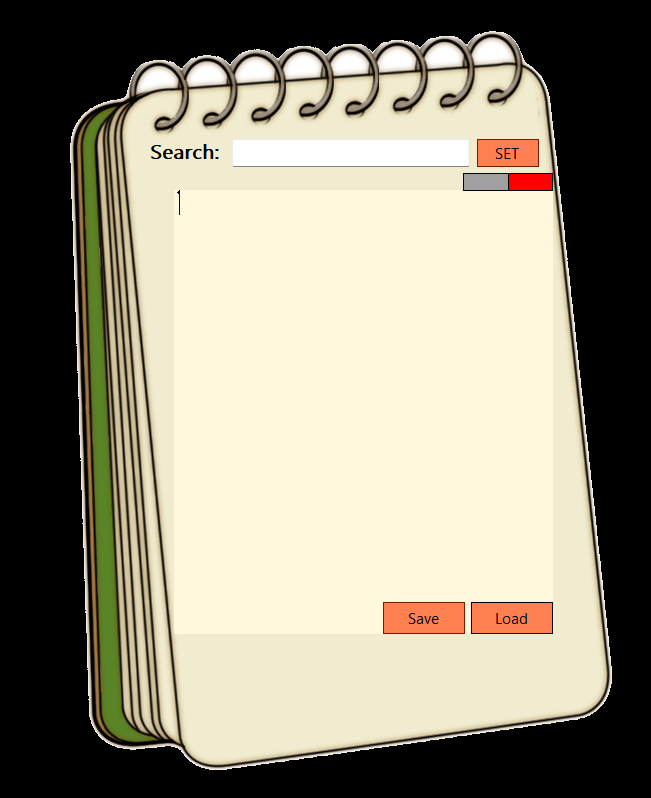

<div align="center">



**A small writing space with the look of a paper notebook**

`C#` · `Windows Forms` · `.NET 5` · `System.IO`

</div>

## A notebook, not another blank window

This is a personal desktop Notepad project built in C# with Windows Forms. Instead of a standard editor window, it uses a spiral bound notebook design, warm paper colours and bright orange controls.

## Inside the app

<div align="center">
  
</div>

The interface includes a writing area, a search field, and **Save** and **Load** buttons.

| What you can do | How it works |
| --- | --- |
| Write and edit | Enter text in the main editor area |
| Save notes | Write the editor contents to a `.txt` file |
| Open notes | Load text from a file using the file picker |
| Find text | Search for a phrase and select its first match |
| Manage the window | Minimise, close, or drag the custom window |

## Built with

- **C#** — application logic and event handlers
- **Windows Forms** — desktop interface and controls
- **System.IO** — reading and writing text files
- **.NET 5 (Windows)** — the project's original target framework

## Run it locally

1. Open `taklife Notepad.sln` in Visual Studio on Windows.
2. Make sure the **.NET desktop development** workload and the required .NET 5 targeting components are available.
3. Build the solution and press **F5** to run it.

> **Compatibility note:** This is an older project targeting .NET 5, which is out of support. Running it may require installing the corresponding development/runtime components. The original project files are preserved as written.

## Project layout

```text
.
├── assets/
│   ├── cover.svg
│   └── notepad-preview.png
├── taklife Notepad/
│   ├── Form1.cs
│   ├── Form1.Designer.cs
│   ├── Form1.resx
│   ├── Program.cs
│   ├── Properties/
│   ├── Resources/
│   └── taklife Notepad.csproj
├── taklife Notepad.sln
├── .gitignore
└── README.md
```

## A note on the project

This project was made as a hands-on Windows Forms exercise, combining event-driven programming, file dialogs, text handling and a custom illustrated interface. It is shared as an original learning project rather than a production-ready editor.
